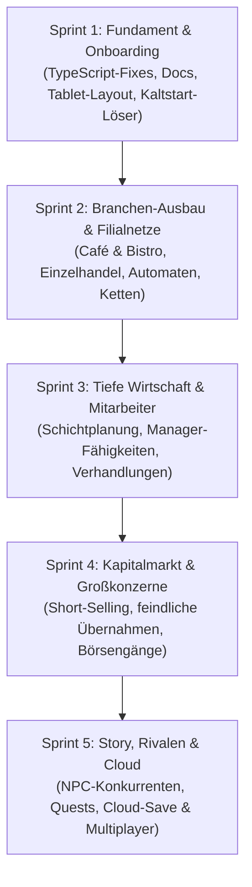

# Empire — Produkt-Roadmap

Dieses Dokument skizziert die langfristige Vision, um *Empire* von einem Prototyp zu einem marktreifen, fesselnden Tycoon-Spiel auszubauen.

---

## 🗺️ Meilenstein-Übersicht

---

### Meilenstein 1: Fundament, Dokumentation & Stabilität (Aktuell)
- [x] Codebase-Audit & QA-Erfahrungsbericht
- [x] Etablierung des Dokumentationssystems (`docs/`)
- [ ] 0 TypeScript-Fehler (`npm run typecheck`)
- [ ] Beseitigung aller Layout-Bugs auf Tablet (768px) und Mobile
- [ ] Beseitigung des doppelten Zurück-Buttons
- [ ] Beseitigung der Toast-Überdeckung im Header
- [ ] Geführter Erst-Start-Banner („3 Schritte zum ersten Umsatz“)

---

### Meilenstein 2: Branchen-Ausbau & Filialen (Geplant)
- Freischaltung von **Café & Bistro** sowie **Einzelhandel & Trendshop** als vollwertige Spielpfade
- Standort-Differenzierung: Fußgängerzone, Hauptbahnhof, Gewerbegebiet mit spürbaren Kundenprofilen
- Filialketten-System mit Logistik-Zentrum und Zentraleinkauf

---

### Meilenstein 3: Management & Personalwesen (Geplant)
- Bewerber-Pool mit Charaktereigenschaften (Zuverlässigkeit, Tempo, Service-Freundlichkeit)
- Schulungen, Prämien und Mitarbeiterzufriedenheit
- Automatisierte Manager-Routinen für Nachbestellungen und Preisanpassungen

---

### Meilenstein 4: Börsen- & Investment-Vertiefung (Geplant)
- Short-Positionen (Leerverkäufe bei überbewerteten Titeln)
- Eigene Unternehmens-Börsengänge (IPO) zur Kapitalbeschaffung
- Firmenfusionen & feindliche Übernahmen von Mitbewerbern

---

### Meilenstein 5: Rivalen, Story & Cloud-Anbindung (Geplant)
- Interaktive NPC-Tycoons als Rivalen auf der Reichen-Rangliste
- Zufalls-Storylines (Gewerbeaufsicht, Skandale, Lieferengpässe)
- Optionale Cloud-Spielstände über das vorbereitete Auth- & DB-System
